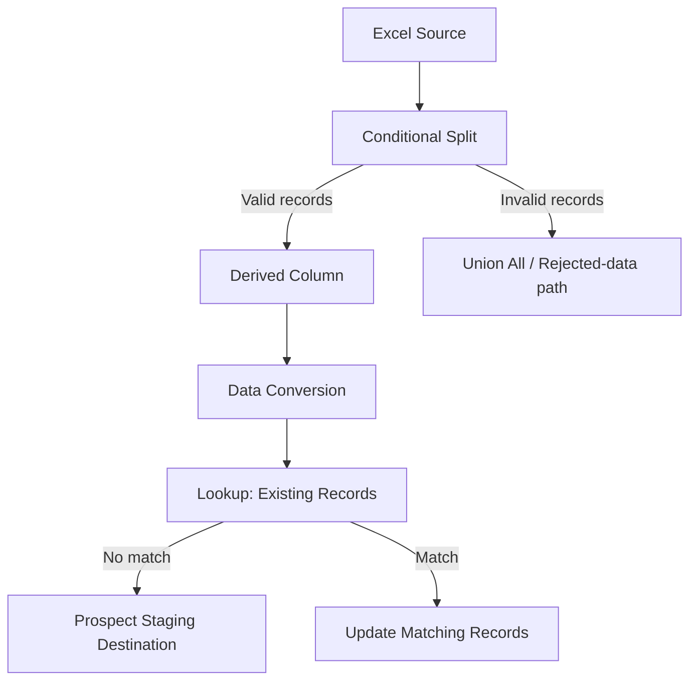

# SSIS Prospect Data Integration | Excel-to-SQL Server ETL Pipeline

An end-to-end **SQL Server Integration Services (SSIS)** project demonstrating prospect-data ingestion, validation, transformation, lookup-based matching, and staging-table maintenance. The pipeline separates invalid records from valid data and routes existing and new prospects through different processing paths.


> **Portfolio note:** This repository documents an SSIS learning/portfolio project. The screenshot captures one package execution; the figures below describe that run, not production throughput. Confirm the dataset's origin and permissions before publishing any source files.

## 📑 Table of Contents

- [Project Overview](#-project-overview)
- [Business Problem](#-business-problem)
- [Pipeline Architecture](#-pipeline-architecture)
- [Execution Results](#-execution-results)
- [SSIS Components](#-ssis-components)
- [Data Quality and Error Handling](#-data-quality-and-error-handling)
- [Technology Stack](#-technology-stack)
- [Project Screenshot](#-project-screenshot)
- [Repository Structure](#-repository-structure)
- [Running the Package](#-running-the-package)
- [Key Learnings](#-key-learnings)

## 🎯 Project Overview

The package `Load_Prospects_Staging.dtsx` reads prospect records from an Excel file, validates them, applies transformations, and uses a lookup to distinguish existing prospects from new ones. Invalid records are routed separately for investigation.

The objective is to demonstrate **repeatable ETL design and data-quality controls** for loading external prospect data into a SQL Server staging environment.

## 💼 Business Problem

Prospect files received from external sources may contain incomplete or invalid records and may overlap with data already stored in a database. Loading every row without validation can introduce errors or duplicates.

This workflow illustrates how to:

- Validate incoming prospect data before loading.
- Separate valid and invalid records.
- Standardize fields and data types.
- Identify existing records using a lookup.
- Route unmatched records to an insert destination and matched records to an update path.

## 🏗️ Pipeline Architecture



**Execution flow:** Excel → Conditional Split → Derived Column → Data Conversion → Lookup → Insert/Update routing. Invalid records follow a separate branch through Union All.

## 📊 Execution Results

The supplied SSIS execution screenshot shows:

| Metric | Records | Notes |
|---|---:|---|
| Excel source | **1,410** | Input rows |
| Valid records | **1,353** | Passed Conditional Split |
| Invalid records | **57** | Routed to rejected-data branch |
| Lookup matches | **1,304** | Routed toward update operation |
| Lookup non-matches | **49** | Calculated as 1,353 − 1,304; routed toward staging destination |

**Valid-record rate:** 95.96% (1,353 / 1,410). **Rejected-record rate:** 4.04% (57 / 1,410).

> These are **data-flow counts**, not independently verified database commit counts. The screenshot does not establish how many insert/update operations ultimately committed successfully.

## ⚙️ SSIS Components

| Component | Role |
|---|---|
| **Excel Source** | Reads the prospect file into the SSIS data flow. |
| **Conditional Split** | Routes valid and invalid records to separate branches. |
| **Derived Column** | Prepares name, title, and location fields for downstream processing. |
| **Data Conversion** | Converts incoming fields to expected data types. |
| **Lookup** | Checks whether prospect records already exist. |
| **Staging Destination** | Receives records with no lookup match. |
| **Update Matching Records** | Processes records that match existing entries. |
| **Union All** | Receives rejected records in the separate bad-data branch shown. |

## 🛡️ Data Quality and Error Handling

The **Conditional Split** identifies 57 records that do not satisfy the package's valid-data rules and directs them away from the main load. The screenshot also shows a separate error output on the Data Conversion transformation, although its downstream handling is not fully visible.

For a production-ready extension, consider a dedicated reject table containing the source row, rejection reason, package execution ID, and processing timestamp. The current screenshot does **not** prove that rejected records are persisted to such a table.

## 🧰 Technology Stack

- **SQL Server Integration Services (SSIS)** — ETL orchestration and data flow.
- **SQL Server Data Tools / Visual Studio** — package development and execution.
- **Microsoft Excel** — external input data.
- **SQL Server** — target staging and record-matching environment, as described in the project.

## 📸 Project Screenshot

### Prospect data flow and row routing


The screenshot illustrates the package's transformation sequence, row counts, and routing between valid, rejected, matched, and unmatched records.

## 📂 Repository Structure

Suggested layout (adjust to the files you actually have):

```text
ssis-prospect-data-etl-pipeline/
├── README.md
├── split.png
└── Load_Prospects_Staging.dtsx   # Include only if available and sanitized
```

Do not upload private prospect information, credentials, or internal SQL Server connection details. If a sample input is shared, use a properly anonymized or synthetic file.

## 🚀 Running the Package

1. Open the SSIS project or `.dtsx` package in a compatible **Visual Studio / SQL Server Data Tools** environment with the SSIS extension installed.
2. Update the **Excel Connection Manager** to reference your local input workbook.
3. Update the **SQL Server connection manager** and ensure the expected staging tables and lookup targets exist.
4. Review column mappings, data types, validation rules, and destination permissions.
5. Execute the package and inspect the Data Flow progress and row counts.
6. Verify the destination records and rejected-data handling independently in SQL Server.

> **Reproducibility:** The screenshot alone does not contain the package configuration, input workbook, table DDL, or connection details. Those artifacts are needed to reproduce the execution exactly.

## 💡 Key Learnings

This project demonstrates core ETL engineering patterns: source ingestion, validation-based routing, derived transformations, type conversion, existing-record detection, staging-table loading, and exception-path design.

It complements Power BI portfolio work by showcasing **upstream data integration and quality management**—the processes that help make downstream analytics reliable.
